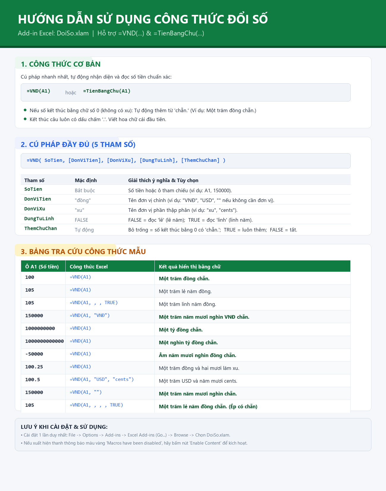

# HƯỚNG DẪN SỬ DỤNG EXCEL ADD-IN: ĐỔI SỐ THÀNH CHỮ (DoiSo.xlam)



---

## 📌 Giới thiệu tổng quan

**`DoiSo.xlam`** là tiện ích mở rộng (Add-in) dành cho Microsoft Excel, cung cấp hàm người dùng tự định nghĩa (**UDF**) giúp chuyển đổi số tiền thành chữ tiếng Việt có dấu chuẩn Unicode.

### ✨ Các tính năng nổi bật:
* **Chuẩn Unicode 100%**: Sử dụng bảng mã Unicode chuẩn quốc tế, không bị lỗi font trên mọi phiên bản Excel và Windows.
* **Quy tắc tiếng Việt chuẩn mực**:
  * Tự động thêm từ **"chẵn."** khi số kết thúc bằng chữ số `0` (ví dụ: *Một trăm đồng chẵn.*).
  * Luôn kết thúc bằng **dấu chấm `.`**.
  * Phát âm chuẩn xác: phân biệt *mười* / *mươi*, *một* / *mốt*, *năm* / *lăm*, *lẻ* / *linh*.
* **Xử lý số lớn không giới hạn**: Hỗ trợ mọi cấp số từ hàng đơn vị đến hàng nghìn tỷ, triệu tỷ, tỷ tỷ... mà không bị lỗi tràn số (*Overflow*).
* **Hỗ trợ số âm**: Tự động thêm tiền tố *"Âm "* (ví dụ: *Âm năm mươi nghìn đồng chẵn.*).
* **Hỗ trợ phần thập phân (xu)**: Tự động quy đổi và làm tròn tiền xu (*và hai mươi lăm xu.*).
* **Tùy biến cao**: Cho phép đổi đơn vị tiền tệ tùy ý (VNĐ, USD, Cents, EUR...), tùy chọn từ nối *"lẻ"* hay *"linh"*.

---

## 🛠️ Hướng dẫn cài đặt Add-in vào Excel

Chỉ cần cài đặt một lần, bạn có thể sử dụng hàm `=VND()` trên mọi file Excel mở trên máy tính.

### Bước 1: Mở khóa file (nếu cần)
1. Nhấp chuột phải vào file **`DoiSo.xlam`** $\rightarrow$ Chọn **Properties**.
2. Ở tab **General**, nếu thấy mục **Security** có dòng *"This file came from another computer..."*, tích chọn vào ô **Unblock** $\rightarrow$ Nhấn **Apply** $\rightarrow$ **OK**.

### Bước 2: Cài đặt Add-in vào Excel
1. Mở phần mềm **Microsoft Excel** lên.
2. Vào menu **File** $\rightarrow$ Chọn **Options** (ở góc dưới bên trái).
3. Trong hộp thoại *Excel Options*, chọn mục **Add-ins** ở cột bên trái.
4. Ở góc dưới cùng, tại mục **Manage**, chọn **Excel Add-ins** $\rightarrow$ Nhấn nút **Go...**
5. Trong cửa sổ *Add-ins* hiện ra:
   * Nhấn nút **Browse...**
   * Tìm và chọn đến file **`DoiSo.xlam`** trên máy tính của bạn $\rightarrow$ Nhấn **OK**.
   * Đảm bảo ô bên cạnh tên Add-in đã được **tích dấu chọn (V)**.
   * Nhấn **OK** để hoàn tất.

---

## 📖 Hướng dẫn sử dụng các hàm

Add-in cung cấp 2 tên hàm tương đương nhau:
* `=VND(...)`
* `=TienBangChu(...)`

---

### 1. Cú pháp cơ bản (Phổ biến nhất)

```excel
=VND(SoTien)
```
Hoặc:
```excel
=TienBangChu(SoTien)
```

* **`SoTien`**: Ô chứa số tiền cần chuyển (ví dụ: `A1`) hoặc số tiền trực tiếp (ví dụ: `150000`).

#### 💡 Ví dụ thực tế:
| Công thức | Kết quả trả về | Ghi chú |
| :--- | :--- | :--- |
| `=VND(100)` | **Một trăm đồng chẵn.** | Kết thúc bằng 0 $\rightarrow$ có *"chẵn."* |
| `=VND(10)` | **Mười đồng chẵn.** | Kết thúc bằng 0 $\rightarrow$ có *"chẵn."* |
| `=VND(150000)` | **Một trăm năm mươi nghìn đồng chẵn.** | Số tròn chục nghìn $\rightarrow$ có *"chẵn."* |
| `=VND(3000000000)` | **Ba tỷ đồng chẵn.** | Số tiền hàng tỷ |
| `=VND(105)` | **Một trăm lẻ năm đồng.** | Tận cùng là 5 $\rightarrow$ kết thúc bằng *"đồng."* |
| `=VND(21)` | **Hai mươi mốt đồng.** | Tận cùng là 1 $\rightarrow$ kết thúc bằng *"đồng."* |
| `=VND(-50000)` | **Âm năm mươi nghìn đồng chẵn.** | Số âm tự động có chữ *"Âm"* |
| `=VND(0.5)` | **Không đồng và năm mươi xu.** | Phần thập phân đọc thành xu |
| `=VND(100.25)` | **Một trăm đồng và hai mươi lăm xu.** | Phần nguyên + phần xu lẻ |

---

### 2. Cú pháp mở rộng với đầy đủ tham số

```excel
=VND(SoTien, [DonViTien], [DonViXu], [DungTuLinh], [ThemChuChan])
```

#### Chi tiết các tham số:
| Tham số | Bắt buộc | Mặc định | Ý nghĩa & Tùy chọn |
| :--- | :---: | :---: | :--- |
| **`SoTien`** | **Có** | — | Số tiền hoặc ô chứa số tiền (ví dụ: `A1`). |
| **`DonViTien`** | Không | `"đồng"` | Tên đơn vị tiền tệ chính (ví dụ: `"VNĐ"`, `"USD"`, `"đồng chẵn"`, `""`...). |
| **`DonViXu`** | Không | `"xu"` | Tên đơn vị tiền tệ phần thập phân (ví dụ: `"xu"`, `"cents"`...). |
| **`DungTuLinh`** | Không | `FALSE` | • `FALSE`: Dùng từ **"lẻ"** (*Một trăm lẻ năm đồng.*)<br>• `TRUE`: Dùng từ **"linh"** (*Một trăm linh năm đồng.*) |
| **`ThemChuChan`** | Không | *Tự động* | • *Bỏ trống*: Tự động thêm *"chẵn."* nếu số kết thúc bằng chữ số `0`.<br>• `TRUE`: Bắt buộc thêm *"chẵn."* cho mọi số nguyên không có xu.<br>• `FALSE`: Tắt hẳn từ *"chẵn."*, chỉ kết thúc bằng dấu chấm `.`. |

---

### 3. Các ví dụ nâng cao

#### A. Dùng từ "linh" thay vì "lẻ" (theo cách đọc miền Bắc):
```excel
=VND(105, , , TRUE)
```
$\rightarrow$ **Một trăm linh năm đồng.**

#### B. Đổi sang đơn vị khác (VNĐ, USD, Cents):
```excel
=VND(150000, "VNĐ")
```
$\rightarrow$ **Một trăm năm mươi nghìn VNĐ chẵn.**

```excel
=VND(100.25, "USD", "cents")
```
$\rightarrow$ **Một trăm USD và hai mươi lăm cents.**

#### C. Chỉ lấy chữ, không lấy đơn vị tiền tệ:
```excel
=VND(150000, "")
```
$\rightarrow$ **Một trăm năm mươi nghìn chẵn.**

#### D. Ép mọi số tiền đều có chữ "chẵn" (kể cả số tận cùng không phải 0):
```excel
=VND(105, , , , TRUE)
```
$\rightarrow$ **Một trăm lẻ năm đồng chẵn.**

#### E. Tắt chữ "chẵn" đối với số tận cùng là 0:
```excel
=VND(100, , , , FALSE)
```
$\rightarrow$ **Một trăm đồng.**

---

## ❓ Câu hỏi thường gặp & Khắc phục sự cố

### 1. Gõ công thức `=VND(...)` bị lỗi `#NAME?`
* **Nguyên nhân**: Excel chưa kích hoạt Add-in `DoiSo.xlam`.
* **Cách xử lý**:
  1. Kiểm tra lại bước cài đặt ở mục **Hướng dẫn cài đặt** phía trên.
  2. Đảm bảo ô Add-in `DoiSo` đã được tích dấu chọn trong cửa sổ *Excel Add-ins*.

### 2. Xuất hiện thông báo bảo mật "Security Warning - Macros have been disabled"
* **Cách xử lý**: Nhấn nút **Enable Content** (Bật nội dung) trên thanh thông báo màu vàng ngay bên dưới thanh công cụ của Excel.

### 3. File backup nằm ở đâu?
* Toàn bộ lịch sử các phiên bản trước khi chỉnh sửa đều được tự động lưu trữ trong thư mục:
  `backup/` với định dạng `DoiSo.xlam-YYYYMMDD-HHMMSS.bak`.
